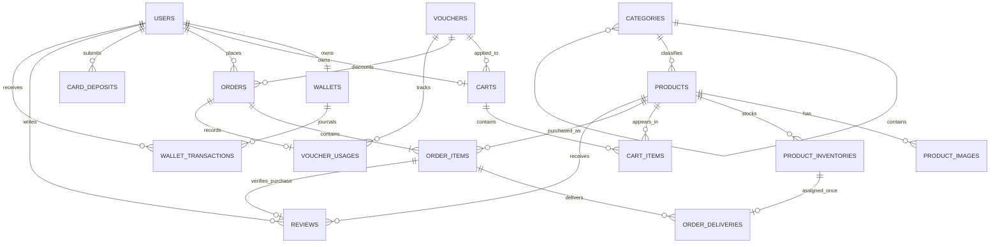

# ShopKey Architecture Blueprint

## Baseline

- Laravel 12 with PHP 8.2+ and Laravel Sanctum 4.
- Browser clients use Blade routes and the Laravel session guard.
- Mobile clients use `/api/v1` and Sanctum bearer tokens.
- MySQL is the production database; SQLite remains available for isolated tests.
- Monetary values are integer VND amounts. No monetary column uses floating point.

## Domain ERD



## Tables and integrity rules

| Domain | Tables | Important constraints |
| --- | --- | --- |
| Identity | `users`, `password_reset_tokens`, `sessions`, `personal_access_tokens` | Unique email/phone; indexed role and lock state |
| Catalog | `categories`, `products`, `product_images` | Unique category/product slugs and SKU; products archive through soft deletes |
| Inventory | `product_inventories`, `order_deliveries` | Encrypted payloads; unique product/fingerprint; each inventory row may be delivered once |
| Cart | `carts`, `cart_items` | One cart per user/session; one row per cart/product |
| Orders | `orders`, `order_items` | Unique public order code; immutable product and price snapshots |
| Discounts | `vouchers`, `voucher_usages` | Unique code; one usage record per order; per-user lookup index |
| Wallet | `wallets`, `wallet_transactions` | One wallet per user; append-only balance ledger; unique idempotency key |
| Deposits | `card_deposits` | Cryptographically generated unique request ID; hashes/encrypted temporary secrets; status indexes |
| Trust | `reviews`, `notifications`, `activity_logs` | One review per purchased product/user; review linked to an order item; auditable admin actions |

Inventory payloads and delivered payload snapshots are encrypted by Laravel's encrypted casts. A SHA-256 fingerprint rejects importing the same inventory value twice for one product without exposing it. Checkout and deposit callback services acquire row locks and run inside database transactions. Wallet changes always append a ledger row with an idempotency key.

For percentage vouchers, `discount_value` is stored as an integer percentage (`15` = 15%). For fixed vouchers it is an integer VND amount.

## Proposed route map

### Web

| Area | Routes | Access |
| --- | --- | --- |
| Storefront | `/`, `/products`, `/products/{product:slug}` | Public |
| Authentication | `/register`, `/login`, `/forgot-password`, `/reset-password/{token}` | Guest |
| Account | `/account`, `/account/password`, `/orders`, `/orders/{order:order_code}` | Customer |
| Cart and checkout | `/cart`, `/checkout` | Customer; mutations use CSRF-protected POST/PATCH/DELETE |
| Wallet | `/wallet`, `/wallet/deposit/card`, `/wallet/deposits` | Customer |
| Administration | `/admin/*` | Authenticated admin/staff plus policy checks |

### API

All mobile endpoints are versioned under `/api/v1`. Public resources are categories and product browsing. Authentication, cart, checkout, orders, wallet, deposits, and profile routes use `auth:sanctum`. The Naptudong callback lives at `/api/payment/naptudong/callback`, outside user authentication, with provider signature verification and rate limiting.

## Application folders

```text
app/
├── Enums/
├── Http/
│   ├── Controllers/
│   │   ├── Admin/
│   │   ├── Api/V1/
│   │   └── Web/
│   ├── Middleware/
│   ├── Requests/
│   └── Resources/
├── Models/
├── Policies/
├── Services/
├── Events/
├── Listeners/
└── Jobs/
```

Controllers coordinate validated requests and responses. Stateful business operations live in services. Policies and middleware enforce access at the backend. API Resources own JSON representation. Repositories are added only where a domain query abstraction provides concrete value.

## Implementation milestones

1. Laravel foundation, schema, models, enums, Sanctum, and schema tests.
2. Session/API authentication, profile, password flows, roles, middleware, and policies.
3. Category and product management, storefront queries, filtering, sorting, and pagination.
4. Encrypted digital inventory import, stock aggregation, reservation, and delivery service.
5. Persistent cart, quantity validation, totals, and voucher preview.
6. Wallet creation and transaction-ledger service with concurrency protection.
7. Atomic checkout, wallet debit, orders, delivery, refunds, and reviews.
8. Naptudong service implemented from supplied official API documentation, signed callback, and idempotency tests.
9. Admin dashboard and management screens with activity logging.
10. Versioned Sanctum REST API and API Resources for mobile.
11. Full feature/unit test suite, factories, realistic local seed data, and edge-case coverage.
12. Responsive ShopKey Blade/Tailwind design and accessibility polish.
13. OpenAPI/Postman documentation, production configuration, deployment guide, HTTPS, queues, and operational checks.
